# ElbowDog V5 强化学习训练迭代记录

记录每一轮做了什么、为什么这样做、结果如何、发现了什么问题。所有数字都来自本目录下的脚本输出，
对应文件路径写在每节末尾，可复算。

---

## 第 0 轮：模型准备（URDF → 训练模型）

### 0.1 电机参数：不用结构分析里的 12 N·m / 8 rad/s

设计包 URDF 里所有关节 `effort=12, velocity=8` 是姿态演示的人为限幅（`design_parameters.json` 注明 “12 Nm is a
simulation cap”）。按 8 rad/s 估算，腿摆动时足端相对髋的最大速度约 8 × 0.24 ≈ 1.9 m/s，机身速度只能到 1 m/s 左右，
达不到课程要求的 2 m/s。因此训练模型改用数据手册：

| 关节 | 电机 | 峰值转矩 | 最高转速 | 来源 |
|---|---|---|---|---|
| 髋侧摆、大腿 | Unitree GO-M8010-6 | 23.7 N·m | 30 rad/s（24 V） | GO-M8010-6 用户手册 |
| 膝（小腿） | Unitree IM6014（N6014B-12.6） | 31.7 N·m（转矩与转速同向） | 54.2 rad/s@60 V → 24 V 下 21.7 rad/s | 宇树 IM6014 产品页 |

- 母线电压取 24 V：GO-M8010-6 只能工作在 12–30 V，单一母线时 IM6014 也是 24 V，空载转速按电压比例折算。
  宇树文档在纯力矩模式下实测 IM6014 空载约 21.9 rad/s，与折算值一致。
- 转矩—转速采用直流电机包络：同向（电动）象限可用转矩 = 峰值 × (1 − ω/ω_max)，反向（制动）象限可到峰值。
  这比“峰值转矩一直可用”保守，转速越高可用转矩越小。
- 转子反射惯量（armature）取 0.01 kg·m²，两个仿真器一致。

### 0.2 结构改动（`tools/build_rl_model.py`）

| 改动 | 原因 |
|---|---|
| 足端橡胶垫（BOM 0.055 kg）单独成为 `XX_foot` link，带 r = 16 mm 球形碰撞体；小腿惯量相应扣除 | 训练要读取足端接触力（判断触地、腾空时间、打滑）。扣除时用平行轴定理精确计算，小腿 + 足端合体的质量、质心、惯量与设计完全一致 |
| 机身 2.5 mm 薄板碰撞体换成实心盒（顶板、主体、四个甲板夹块）+ 4 个电机圆柱 | 薄板在 PhysX 中容易穿透，机身触地（摔倒判定）检测不可靠 |
| 去掉关节 damping/friction 和 gazebo 标签 | 关节摩擦改为在训练环境里显式建模并随机化 |
| 同一脚本同时生成 MJCF | 保证 Isaac Gym 和 MuJoCo 的质量、惯量、碰撞体、限位完全同源 |

总质量 13.215771 kg（与设计报告一致）；生成后检查所有惯量正定且满足三角不等式。

### 0.3 模型检查（`tools/check_model_isaac.py`，结果 `logs/model_check/report.json`）

- **Isaac Gym 是否改写惯量**：legged_gym 设置刚体属性时传 `recomputeInertia=True`。实测惯量不变，URDF 惯量被正确使用。
- **关节正方向**（固定机身，各关节 +0.3 rad，看 FL/FR 足端位移）：

| 关节 +0.3 rad | 足端变化 | 含义 |
|---|---|---|
| 髋侧摆 | FL 向 +y（外摆）、FR 向 +y（内收） | 两侧轴向相同，左右对称动作需反号 |
| 大腿 | x 0.125 → 0.054，z −0.239 → −0.228 | 正转 = 膝后移、足后移（全肘式） |
| 小腿 | x 0.125 → 0.086，z −0.239 → −0.260 | 正转 = 腿伸直 |

- **静态载荷不均**：站姿 [0, 0.65, −1.3] 下整机质心在几何中心后方 **2.77 cm**（大腿质心在膝部，因为 IM6014 装在膝上），
  前脚各 25.2 N、后脚各 39.6 N。
- **纯 PD 站立会塌**：Kp = 20（Go1 常用值）从 0.32 m 落下，后腿下沉 → 机身抬头 14° → 后膝 IM6014 壳体触地，
  四脚合力只有 94 N（体重 129.6 N）。Isaac Gym 和 MuJoCo 结果一致，说明这是物理现象而不是模型错误。

| 增益 Kp / Kd | 机身高度 | 俯仰 | 非足端着地力 |
|---|---|---|---|
| 20 / 0.5 | 0.207 m | 14.4° | 35.4 N（后膝着地） |
| 40 / 1.0 | 0.211 m | 16.7° | 8.0 N |
| 80 / 2.0 | 0.245 m | 2.2° | 0 |
| 20 / 0.5 + 重力补偿前馈 | 0.255 m | −1.2° | 0 |

  结论：站姿在主动控制下是稳定的（加前馈 Kp = 20 即可站稳），只是纯 PD 刚度不够。RL 策略输出的位置偏移本身就相当于前馈，
  所以不需要很高的增益；训练取 **Kp = 25、Kd = 0.6**。站稳所需力矩：后膝 3.6 N·m、后髋侧摆 3.4 N·m、大腿约 1 N·m，
  远低于电机能力。

### 0.4 发现的设计包问题（只影响显示）

设计包 `simulation/scene.xml` 用 MJCF 默认的内旋 xyz 欧拉角直接写 URDF 的 rpy（外旋），对两个非零角的姿态
`(−π/2, 0, π)` 结果不同。右侧 FR/RR 的 IM6014 外观网格因此被画到腿外侧（y ∈ [−0.228, −0.169]），碰撞体和 URDF 都在内侧
（[−0.169, −0.110]）。动力学不受影响；本项目生成的 MJCF 改用四元数，位置正确。

---

## 第 1 轮：平地行走 v1（`elbowdog_flat`，run `Nov09_18-12-56_v1`）

### 1.1 设计

- **目的**：先在平地上验证模型、电机模型、奖励和 sim2sim 链路，再上地形；同时拿到一个“快且稳”的基线。
- **观测（actor，48 维）**：机身线速度、角速度、重力投影、指令 (vx, vy, ωz)、12 个关节角（相对站姿）、12 个关节速度、上一步动作。
  **critic 额外 50 维特权信息**：足端接触、足端离地高度、摩擦系数、负载、质心偏移、电机强度、PD 系数、关节摩擦、延迟
  （非对称 actor-critic：价值函数知道随机化参数，学习更快；策略本身不依赖这些量）。
- **动作**：12 个关节目标角偏移 × 0.25 rad，50 Hz；PD 200 Hz，经电机转矩—转速包络限幅。
- **指令课程**：前进速度上限从 1.0 m/s 起步，跟踪奖励达到最大值 75% 时上调 0.25 m/s，最高 3.0 m/s；10% 概率给零指令练习站立。
- **奖励**（每项乘以 dt=0.02）：

| 类别 | 项 | 系数 | 作用 |
|---|---|---|---|
| 任务 | 线速度跟踪 exp(−‖Δv‖²/0.25) | +1.5 | 速度快、跟得准 |
| | 偏航角速度跟踪 | +0.75 | 转向 |
| 平稳 | 竖直速度² | −2.0 | 机身不上下颠 |
| | 横滚/俯仰角速度² | −0.05 | 不晃 |
| | 机身倾斜（重力投影 xy²） | −1.0 | 保持水平 |
| | 机身高度偏离 0.25 m | −10 | 不趴不蹿 |
| | 动作变化² | −0.01 | 动作平滑 |
| | 关节加速度² | −2.5e−7 | 平滑、减冲击 |
| 步态 | 腾空时间（目标 0.25 s） | +1.0 | 抬腿迈步，避免拖脚 |
| | 摆动脚离地不足（目标 6 cm） | −0.3 | 足端净空 |
| | 支撑脚打滑 | −0.1 | 落地踩实 |
| | 髋侧摆偏离站姿 | −0.5 | 腿不外八 |
| 安全/能耗 | 大腿/小腿/髋触地 | −1.0 | 只用脚着地 |
| | 关节限位、力矩限位 | −10 / −0.01 | 不撞限位、不打满电机 |
| | 机械功率 Σ\|τω\| | −2e−4 | 省电 |
| 站立 | 零指令时关节偏离、抬脚 | −0.5 / −0.3 | 站得住、站得稳 |

- **域随机化**：摩擦 0.3–1.25、负载 −0.5~+3 kg、质心 ±3/2/2 cm、Kp/Kd ±15%、电机强度 ±10%、关节库仑摩擦 0–0.3 N·m、
  粘性 0–0.03、控制延迟 0–10 ms、每 8 s 随机外推 0.8 m/s。
- 4096 个并行环境，1500 次迭代（1.47 亿步），RTX 4090 笔记本约 49 分钟（与地形训练并行时会变慢）。

### 1.2 训练过程

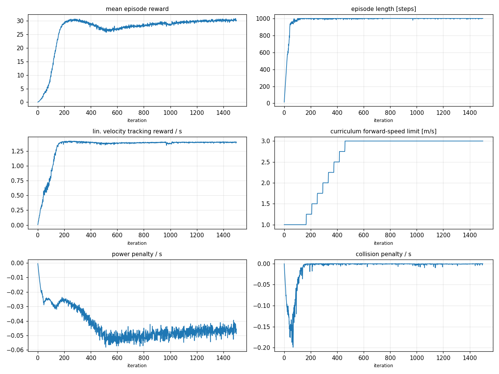

约 130 次迭代后回合长度跑满（不再摔倒）；速度课程在第 ~500 次迭代升到 3.0 m/s 上限，跟踪奖励保持在最大值的 92%。

### 1.3 Isaac Gym 评估（无噪声、无随机化，每档 32 台机器人，`eval/speed_sweep.json`）

| 指令 m/s | 成功率 | 实际速度 | 跟踪误差 | 横滚 RMS | 俯仰 RMS | 机身高度 | 机械功率 | CoT |
|---|---|---|---|---|---|---|---|---|
| 0.5 | 100% | 0.495 | 0.9% | 1.24° | 1.18° | 0.235 m | 59 W | 0.92 |
| 1.0 | 100% | 0.993 | 0.7% | 0.91° | 0.99° | 0.238 m | 132 W | 1.03 |
| 1.5 | 100% | 1.486 | 0.9% | 0.89° | 0.90° | 0.245 m | 193 W | 1.00 |
| 2.0 | 100% | 1.991 | 0.4% | 0.31° | 0.70° | 0.253 m | 253 W | 0.98 |
| 2.5 | 100% | 2.471 | 1.2% | 0.54° | 0.90° | 0.254 m | 332 W | 1.04 |
| 3.0 | 100% | 2.960 | 1.3% | 1.05° | 1.08° | 0.257 m | 429 W | 1.12 |

CoT（运输成本）= Σ\|τω\| / (m g v)，按机械功率绝对值计算（正负功都算），不含电机发热，所以偏大，仅用于版本间比较。

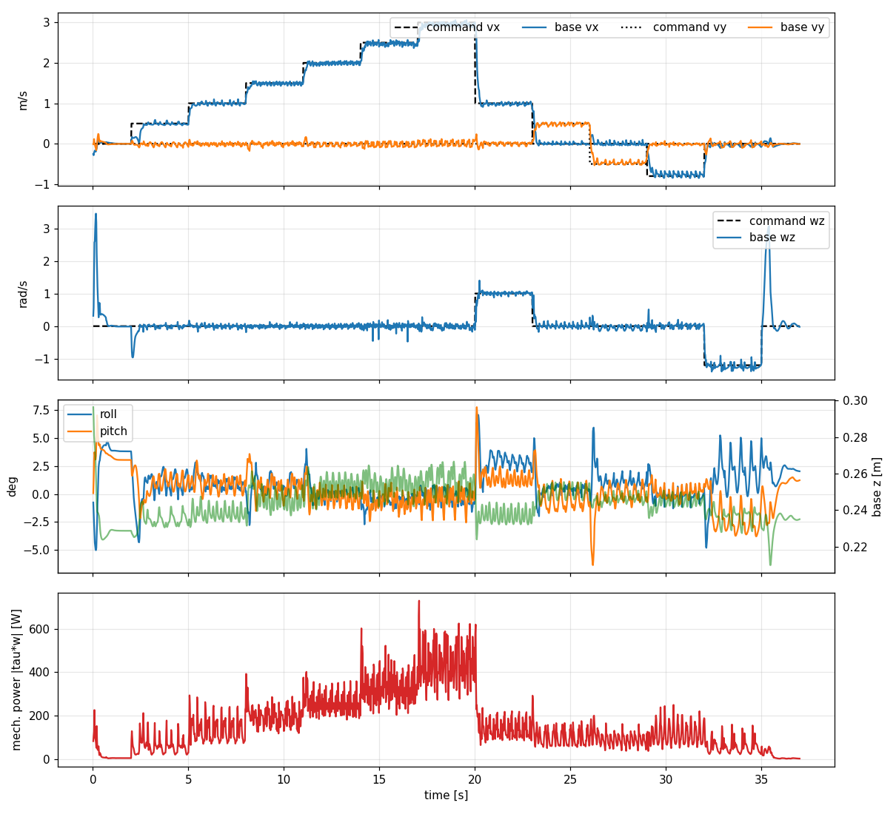

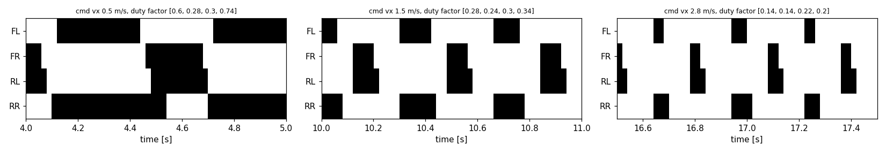

- **步态**：1.5 m/s 为标准对角小跑（FL+RR / FR+RL 交替，约 2.7 Hz，带腾空相）；2.8 m/s 为腾空小跑（约 3.4 Hz，单脚占空比 0.14–0.22）。
- **问题 1：低速步态不对称**。0.5 m/s 时 FL/RR 占空比 0.60/0.74，FR/RL 只有 0.28/0.30，像轻微跛行；对应高速时 −3° 左右的横滚偏置
  （中间检查点更明显）。
- **问题 2：高速冲击力大**。演示全程（含 3 m/s）足端竖直力 99 分位 315 N、峰值 800 N；大腿峰值力矩 22.9 N·m（上限 23.7）、
  后膝 29.1 N·m（上限 31.7）。**结构反馈**：设计报告里有限元筛查载荷为单脚 300 N，3 m/s 奔跑时约 1% 的时间超过该值，
  若要在实物上跑这么快，应按 RL 统计的载荷谱重新校核（`eval/demo_gait_peaks.json`）。

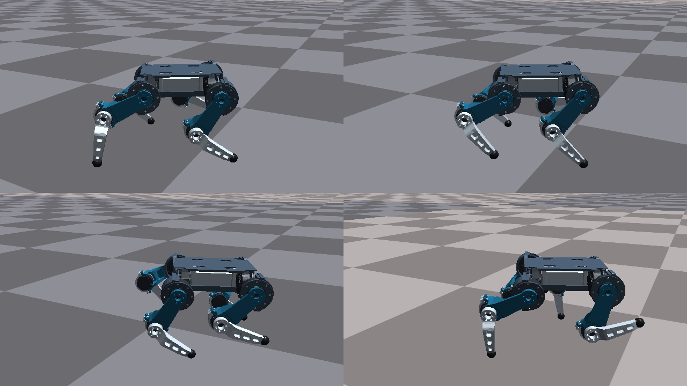

### 1.4 MuJoCo sim2sim（`sim2sim/mujoco_speed_sweep_*.json`）

同一策略直接放进 MuJoCo，不做任何微调。MuJoCo 的接触模型（软约束）、PD 频率（500 Hz）、关节摩擦（frictionloss）都与训练不同。

| 指令 m/s | 0.5 | 1.0 | 1.5 | 2.0 | 2.5 | 3.0 |
|---|---|---|---|---|---|---|
| Isaac 实际速度 | 0.495 | 0.993 | 1.486 | 1.991 | 2.471 | 2.960 |
| MuJoCo 实际速度 | 0.413 | 0.941 | 1.461 | 2.001 | 2.499 | 2.955 |
| MuJoCo 俯仰 RMS | 1.8° | 2.1° | 4.1° | 4.8° | 4.1° | 4.2° |

所有速度都没有摔倒，2 m/s 以上跟踪误差 ≤1.5%。逐项改变 MuJoCo 参数找差距来源：

| 变体 | 结果 | 结论 |
|---|---|---|
| 关节摩擦 0 / 0.1 / 0.3 N·m | 几乎不变 | 关节摩擦随机化有效 |
| 控制延迟 10 ms | 几乎不变 | 延迟随机化有效 |
| 椭圆摩擦锥 impratio 10/100 | 几乎不变 | 与摩擦锥无关 |
| PD 200 Hz（dt 5 ms，与训练相同） | 3.0 m/s 摔倒 | 高速步态对积分步长敏感 |
| 接触更硬（solref 0.02 → 0.005） | 低速更稳（俯仰 1–2°），2.5 m/s 以上剧烈点头（俯仰 RMS 29–36°） | **高速步态对接触刚度最敏感** |

- 低速（0.5 m/s）在所有变体下都慢约 17%，高速时 MuJoCo 里机身低 2–3 cm、功率高约 40%：MuJoCo 软接触像阻尼器，吸收了能量。
- **反思**：PhysX 接触近似刚性，训练里没有随机化接触软硬，所以高速步态“记住”了一种接触特性。改进方向是在训练中随机化
  接触参数（或加地形软硬随机化），并降低冲击力（第 2 轮地形训练中改进）。

## 第 2 轮：地形 v1（`elbowdog_rough`，run `Nov09_18-23-02_v1`）

### 2.1 设计

在平地策略之外从头训练感知地形的策略。相对平地配置的差别（`ElbowDogRoughCfg`）：

- 观测增加 15×9 = 135 点高度扫描（机身前方 0.8 m、后方 0.6 m、左右各 0.4 m，间隔 0.1 m）。
- 地形 10 行难度 × 20 列类型：平地、上坡、下坡、带噪坡、上台阶、下台阶、离散障碍、碎石。
  最难一行（难度 0.9）为 34.2° 坡、15.6 cm 台阶、11 cm 障碍块、±5.5 cm 碎石。每块中央 2 m 平台出生。
- 课程要求对应：30° 坡是第 8 级（30.4°），12 cm 台阶介于第 6 级（11.4 cm）和第 7 级（12.8 cm）。
- 障碍地形的前进指令上限低于平地（坡 1.5、台阶 1.0、障碍 1.2、碎石 2.0 m/s）；负载随机化扩大到 −0.5~+5 kg。
- 机身姿态、高度惩罚减弱，摆动脚目标离地 7 cm，并惩罚足端磕到竖直表面。

4096 环境，计划 4000 次迭代。约第 1870 次迭代时主动停止，用 `model_1800.pt` 评估，腾出 GPU 做 v2 微调。

### 2.2 训练过程

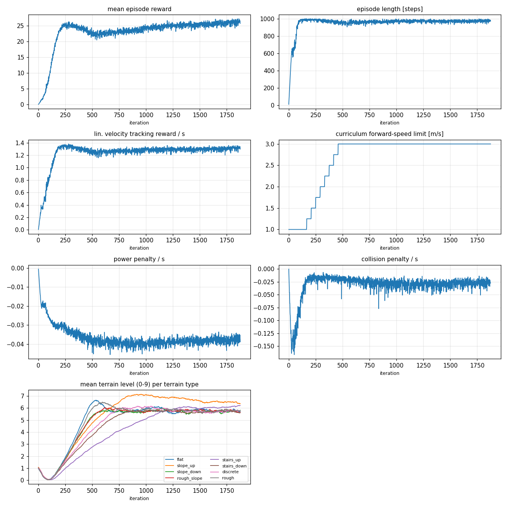

约 600 次迭代后回合不再提前结束，速度课程升到 3 m/s。各地形的平均难度停在 5.5–6.9 级（约 19–26°、10–12 cm 台阶），没有继续爬到最难一行：走得慢的机器人会被降级，所以高难度地块上剩下的多是高速指令。

### 2.3 评估判据

第 1200 次迭代用过一个宽松判据（离开地块中心 4 m 内的任意方向都算通过），各地形接近 100%，**该结果作废**（`eval/terrain_sweep.json`）。

现行判据：机器人朝 +x 放在地块中心，指令为该地形允许的速度与给定速度中的较小值，在限时内沿 +x 前进 3.5 m（越过整段坡或台阶）才算通过。

### 2.4 第 1800 次迭代、0.5 m/s（`eval/terrain_sweep_v0.5.json`）

通过率。括号内是摔倒率；没写的摔倒率都是 0，失败是卡住而不是摔倒。

| 地形 | 第 6 级 | 第 7 级 | 第 8 级（30.4° / 14.2 cm） | 第 9 级（34.2° / 15.6 cm） |
|---|---|---|---|---|
| 上坡 | 100% | 100% | 100% | 100% |
| 下坡 | 62% | 69% | 62% | 25% |
| 带噪坡 | 100% | 100% | 67% | 88% |
| 上台阶 | 83%（11.4 cm） | 88%（12.8 cm） | 71% | 92% |
| 下台阶 | 21%（11.4 cm） | 17%（12.8 cm） | 8% | 0% |
| 离散障碍 | 75%（8 cm） | 50%（9 cm） | 56%（10 cm） | 50%（摔倒 25%） |
| 碎石 | 100% | 100% | 88% | 75% |

- **上坡达到课程要求**：0.5 m/s 下 30.4° 和 34.2° 都是 100%，且不摔倒。第 1200 次迭代的单机测试还做不到这一点（0.6 m/s 下 12 s 只走 1.38 m，0.8 m/s 走 2.89 m，1.0 m/s 才通过），说明 1200→1800 之间学会了慢速上坡。
- **下坡和下台阶是短板**：机器人停在台阶边缘，不是摔倒。全肘式下台阶时小腿容易顶住立面。
- 12.8 cm 上台阶通过率 88%，达到 120 mm 的要求，但余量不大。

### 2.5 MuJoCo（策略是第 1200 次迭代导出的，比 1800 次更早）

默认软接触：20° 坡 4.5 s 通过，25° 坡 28.9 s 勉强通过，30° 坡停在坡底；8 cm 台阶 30.7 s 通过，10 cm 及以上停在第一级。
接触时间常数改为 0.005 s 后，10 cm 台阶 10 s 通过，30° 坡仍然不行。摩擦锥和指令速度改动都不能让 30° 坡通过。

第 1200 次迭代在 Isaac 里也爬不上慢速 30° 坡，所以这次 sim2sim 失败不能单独归因于仿真器差异。1800 次迭代的策略还没有在 MuJoCo 里测过；v2 微调完成后再统一测。

## 第 3 轮：地形 v2（`Nov09_19-31-16_v2`，从 v1 的 `model_1800.pt` 微调 2000 次）

### 3.1 改了什么

v1 在 0.5 m/s 下下坡、下台阶会停住。原因是障碍地形的前进指令在 [−1, 上限] 里均匀采样，加上地形课程会把走得慢的机器人降级，高难度地块上很少出现“必须慢慢向前爬”的样本。

三处改动（`ElbowDogRoughCfg`、`elbowdog.py`）：

| 改动 | 作用 |
|---|---|
| 上坡、下坡、台阶、离散障碍的前进指令下限改为 0.3 m/s，不再给后退指令 | 这些地形上每次指令都要求向前走 |
| 新增 `forward_progress` 奖励，系数 +0.5：实际前进速度 / 指令速度，截断在 0–1 | 指数型速度跟踪在“完全不动”和“走了一半”之间差别不大；这一项直接奖励走出多远 |
| 摆动脚目标离地高度 7 cm → 9 cm | 抬脚跨过 12 cm 级台阶 |

网络权重来自 v1 第 1800 次迭代，地形课程等级不在检查点里，所以新进程里机器人重新从低难度出生。2000 次迭代用时 53 分钟。

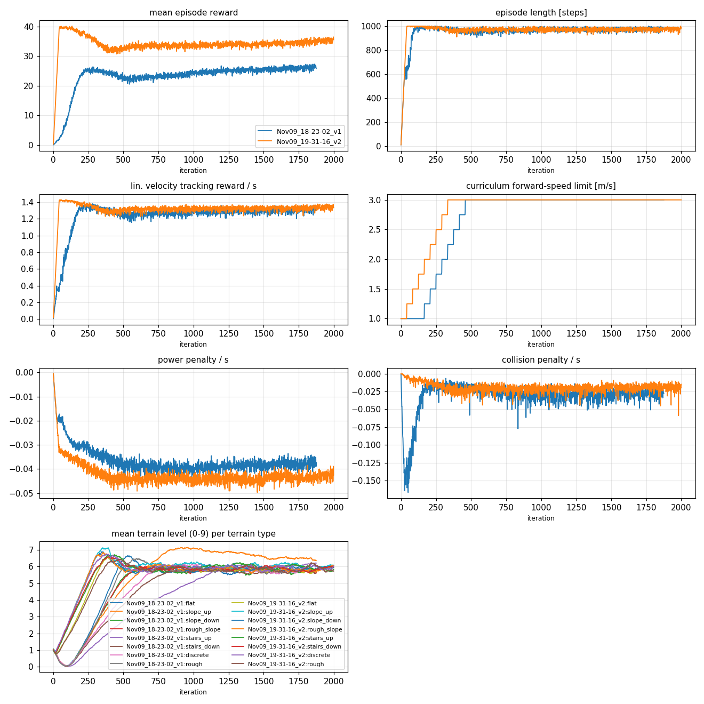

v2 的横轴是这次微调自己的迭代号。奖励从第一轮就在 35–40，说明加载的是已经会走的网络，不是从头训练。地形等级先降到 4 左右再回到 6 左右，和 v1 结束时同一水平：课程会把勉强通过的机器人留在中等难度，通过率要看下面的定点测试，不能看平均等级。

### 3.2 Isaac Gym 定点测试

判据与第 2 轮相同：朝 +x，沿前进方向走出 3.5 m。每格 8 台，同一地形类型的多列取平均。

0.5 m/s，只列出最高两级（完整表在 `eval/terrain_sweep_v0.5.json`）：

| 地形 | v1 第 8 级 | v2 第 8 级 | v1 第 9 级 | v2 第 9 级 |
|---|---|---|---|---|
| 上坡 30.4° / 34.2° | 100% | 100% | 100% | 100% |
| 下坡 | 62% | 100% | 25% | 100% |
| 上台阶 14.2 / 15.6 cm | 71% | 100% | 92% | 100% |
| 下台阶 | 8% | 100% | 0% | 100% |
| 离散障碍 10 / 11 cm | 56% | 94%（摔倒 6%） | 50% | 100% |
| 碎石 | 88% | 100% | 75% | 100% |

1.0 m/s 下 v2 除了 15.6 cm 上台阶是 96%（摔倒 4%），其余全是 100%（`eval/terrain_sweep_v1.json`）。v1 在 1.0 m/s 下已经能上下 30° 坡，但 15.6 cm 上台阶只有 75%、下台阶 83%。

课程指标对应的是第 8 级上坡（30.4°）和第 7 级台阶（12.8 cm）。这两项在 0.5 和 1.0 m/s 都是 100%。单台跟拍（0.6 m/s，12 s）：

| 地块 | 前进距离 | 平均俯仰 |
|---|---|---|
| 30.4° 上坡 | 5.77 m | +6.8° |
| 12.8 cm 上台阶 | 6.09 m | +6.8° |
| 12.8 cm 下台阶 | 6.15 m | −1.9° |

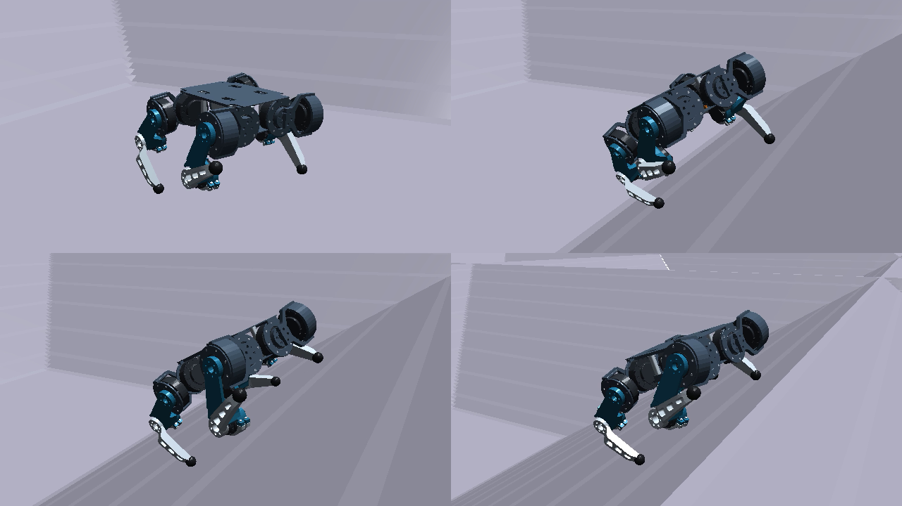

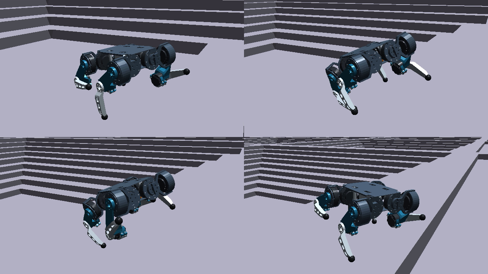

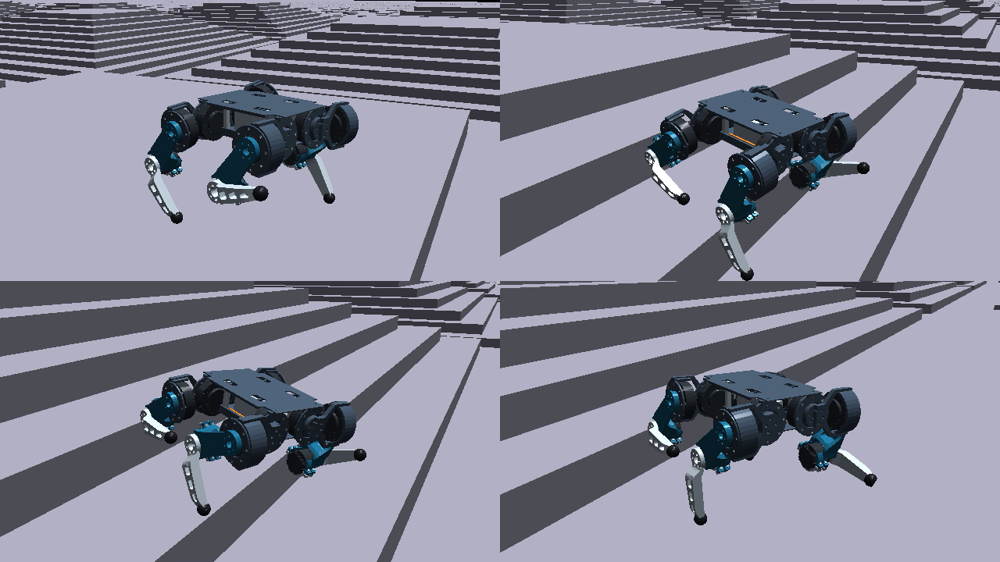

视频在 `logs/elbowdog_rough/Nov09_19-31-16_v2/eval/tile_*.mp4`。

### 3.3 MuJoCo sim2sim

同一份 `exported/policy.pt`，不做微调。默认接触时间常数 0.02 s，指令 0.6 m/s。

| 场景 | 默认接触 | 接触改硬（solref 0.005） |
|---|---|---|
| 20° 坡上 / 下 | 4.5 s / 2.6 s 通过 | — |
| 25°、30° 坡 | 停在坡脚；30° 在 29 s 摔倒，x ≈ 2.3 m | 30° 仍然停在坡脚并摔倒 |
| 8 cm 台阶上 / 下 | 4.7 s / 4.4 s | — |
| 10 cm 台阶上 / 下 | 9.5 s / 4.4 s | — |
| 12 cm 台阶上 / 下 | 11 s 摔倒在第一级 | 7.4 s / 4.5 s 通过 |
| 14 cm 台阶上 / 下 | 停在第一级，不摔倒 | 13.8 s / 4.4 s 通过 |

把 30° 坡的指令改成 0.4 或 1.0 m/s、接触时间常数改成 0.01 s、摩擦锥改成椭圆，都不能通过。卡住时的状态：接近坡脚时机身抬头到约 20°，前进速度掉到 0，然后前后晃。小腿碰地不是主要原因。

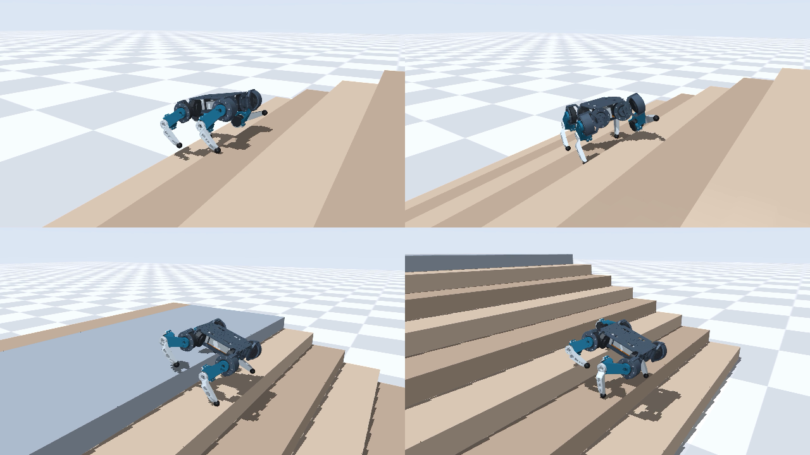

平地速度（地形策略，不是平地专用策略）：0.5–3.0 m/s 都不摔倒。1 m/s 实际 0.96 m/s（误差 4.5%，俯仰 RMS 2.8°），3 m/s 实际 2.75 m/s（误差 8.4%，俯仰 RMS 4.7°）。比平地专用策略（3 m/s 误差 1.5%、俯仰约 4°）略差，功率也更高（3 m/s 时 485 W，平地策略 447 W）。

### 3.4 结论和没做的事

- Isaac Gym 里，0.5 m/s 和 1.0 m/s 都能上、下 30° 以上的坡和 12 cm 以上的台阶，也能过碎石和 10 cm 障碍块。课程要求的 30° 和 120 mm 在这个仿真器里达到了。
- MuJoCo 里 12 cm、14 cm 台阶在接触改硬后能过；20° 坡在默认接触下能过。30° 的光滑坡两边仿真器不一致，没有靠继续加迭代去堵这个差距：Isaac 里这项已经是 100%，再训主要是在重复同一分布。
- 后续如果要缩小这个差距，应在训练里随机化接触刚度，或把一部分坡做成和 MuJoCo 一样的光滑三角面，而不是只加密当前这种 5 cm 高度场。
- 平地策略留下的两个问题这次没有单独处理：0.5 m/s 时左右步态占空比不对称；3 m/s 时足端力 99 分位约 315 N，超过结构有限元用的 300 N 筛查载荷。地形策略的平地功耗也偏高。

## 第 4 轮：平地接入坡 v3（`Nov09_20-42-47_v3`，从 v2 的 `model_2000.pt` 微调 1500 次）

### 4.1 改了什么

v2 在 Isaac 的金字塔坡上能爬 34°，MuJoCo 的 30° 坡却停在坡脚。两边的坡不一样：Isaac 的 `slope_up` 是机器人出生就已经站在里面的金字塔；MuJoCo 的 `ramp30` 是一段平地，然后一个 1.5 m 长的光滑斜面。策略没有学过“从平地走上斜面”。

新增地形 `approach_ramp`（`elbowdog_gym/utils/terrain.py`），剖面和 MuJoCo 的坡一致，沿 +x：

| 区段 | 位置（地块起点起） | 高度 |
|---|---|---|
| 平地 | 0–2.0 m | 0，出生点在 0.7 m |
| 上坡 | 2.0–3.5 m | 坡度 = 38° × 难度，第 8 级 30.4°，第 9 级 34.2° |
| 平台 | 3.5–4.7 m | 坡顶高度 |
| 下坡 | 4.7–6.2 m | 回到 0 |

出生点不在地块中心，而在坡前的平地上，这样原来的“沿 +x 走出 3.5 m”正好要求爬完上坡、走上平台。任务名 `elbowdog_ramp`，配置 `ElbowDogRampCfg`：这种坡占 20% 的列，前进指令 0.3–1.2 m/s。其余奖励和 v2 相同。

v2 的最终检查点里迭代号是 2000，所以这次日志从 2000 计到 3500，实际新训 1500 次，用时 40 分钟（2402 s）。奖励在大约 40 次迭代后回到 37，结束时 37.4；地形平均等级回到 6 左右（课程状态不在检查点里，重新从低难度爬）。

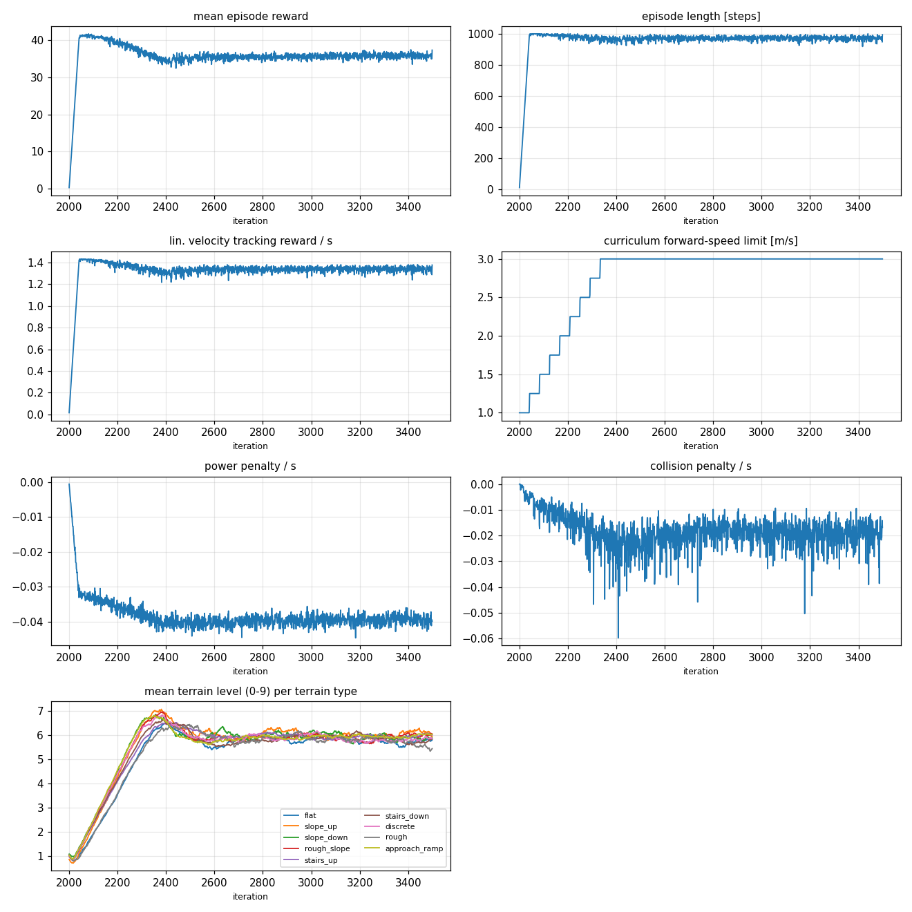

### 4.2 Isaac Gym 定点测试

0.6 m/s，10 级 × 全部地形，每格 8 台。通过率全部是 100%，摔倒率全部是 0（`eval/terrain_sweep_v0.6.json`）。其中包括新的接入坡：第 8 级 30.4°、第 9 级 34.2°，上坡和下坡都在这 3.5 m 里。金字塔坡、14.2 / 15.6 cm 台阶、碎石同样保持 100%。

单台跟拍，接入坡第 8 级，指令 0.6 m/s，12 s 走出 5.91 m。分段平均：

| 区段 | 俯仰 | 前进速度 |
|---|---|---|
| 坡前平地 | +3.9° | 0.50 m/s |
| 30.4° 上坡 | +21.1° | 0.65 m/s |
| 坡顶平台 | +1.3° | 0.60 m/s |
| 下坡及之后 | −13.6° | 0.60 m/s |

上坡时机身顺着坡面抬头约 21°，速度没有掉下来。

### 4.3 MuJoCo sim2sim

同一份 `exported/policy.pt`。指令在障碍上是 0.6 m/s。

| 场景 | 默认接触（solref 0.02） | 接触改硬（solref 0.005） |
|---|---|---|
| 20° 坡上 / 下 | 3.5 s / 2.7 s 通过 | — |
| 25° 坡上 / 下 | 6.3 s / 2.8 s 通过 | — |
| 30° 坡 | 9.8 s 摔倒，停在坡脚 x ≈ 2.2 m | 45 s 仍停在 x = 2.26 m，不摔倒 |
| 12 cm 台阶上 / 下 | 17.9 s / 4.3 s 通过 | 5.6 s / 4.6 s 通过 |

和 v2 比，25° 坡从“停在坡脚”变成通过，12 cm 台阶在默认软接触下也能上下（v2 要改硬接触才过 12 cm）。30° 光滑坡没有过。

把 30° 坡的指令改成全程恒定的 0.4、0.6、0.8、1.0 m/s，软接触和硬接触都停在坡脚。卡住时的状态和 v2 相同：x ≈ 2.2 m（刚踏上斜面），俯仰约 +15°，前进速度掉到 0 附近，支撑脚切向速度接近 0（不是一直打滑）。把地面滑动摩擦从 1.0 调到 1.4、同时接触改硬，有一次 28 s 走完了上下坡；1.2 和 1.6 在同样设置下仍停在坡脚。摩擦不是一个稳定的开关，不能当成解决方案。

### 4.4 结论

- 训练分布补上“平地走到斜面”之后，Isaac 里 30.4° 和 34.2° 的接入坡在 0.6 m/s 下通过率 100%，机身在坡上抬头约 21° 并保持 0.65 m/s。
- MuJoCo 的差距缩小了：25° 光滑坡和 12 cm 台阶（默认接触）现在能过。
- 30° 光滑楔形坡仍然在坡脚停住。同一策略在 Isaac 的高度场坡上能爬，MuJoCo 的单平面坡上抬头之后速度掉到 0。继续在同一种高度场上加迭代，解决不了这个接触差异。

## 第 5 轮：少打滑、爬得快一点（v5、v6）

看录像时坡上的脚在蹭，25° 坡要 6 秒才走完 1.5 m。这一轮只改奖励，地形和网络都没动。v4 开跑两分钟后停掉了，没有结果，目录 `Nov09_21-36-35_v4` 可以忽略。

### 5.1 v5（`Nov09_21-40-54_v5`，从 v3 的 `model_3500.pt` 再训 1500 次）

两处改动（`ElbowDogRampCfg`、`elbowdog.py`）：

| 改动 | 作用 |
|---|---|
| 新增 `slope_slip`，系数 −1：支撑脚水平速度 × 机头方向的地面坡度 | 平地上这项接近 0，只罚坡上打滑 |
| `forward_progress` 从 0.5 提到 1.0 | 走得比指令慢时，少拿的奖励比原来多 |

迭代号 3500→5000，用时 39 分钟（2323 s）。结束时奖励 42.2，前进比例 0.87，地形等级仍在 6 左右。全地形平均的 `feet_slip` 仍是 −0.029，和 v3 的 −0.030 几乎一样：坡度加权之后这项还是太轻，策略没怎么改踩地方式。

MuJoCo，默认接触，障碍指令 0.6 m/s。和 v3 比的是同一条坡上的平均前进速度：

| 场景 | v3 | v5 |
|---|---|---|
| 25° 上坡 | 6.3 s，0.25 m/s | 3.8 s，0.43 m/s |
| 25° 下坡 | 2.8 s | 2.7 s |
| 12 cm 上台阶 | 17.9 s，0.13 m/s | 15.4 s，0.17 m/s |
| 30° 坡 | 9.8 s 摔倒在坡脚 | 25 s 停在 x = 2.24 m，不摔倒，也没爬上去 |

25° 坡快了约 70%。30° 只是不再向后摔倒。录像在 `sim2sim/mujoco_*_v5.mp4`，桌面副本在 `桌面/ElbowDog_V5_结构优化与三维仿真/强化学习录像/v5_*.mp4`。Isaac 定点扫描这轮没重跑，当时 v6 已经占着 GPU。

### 5.2 v6（`Nov09_22-24-12_v6`，从 v5 的 `model_5000.pt` 再训 1500 次）

v5 的打滑惩罚太轻，所以加重了：

- `slope_slip` 改为 −4，并且脚速再加一项 4 × 速度²，蹭得越快罚得越重。
- 原有的 `feet_slip` 从 −0.1 提到 −0.3，平地上的打滑也更贵。

迭代号 5000→6500，用时 36 分钟（2145 s）。结束时奖励 39.2，回合长度 975（20 秒回合的上限附近，没有练崩），前进比例 0.86，和 v5 的 0.87 一样。`feet_slip` 的系数是 v5 的 3 倍，记录值从 −0.029 变成 −0.061；若脚还是同样在滑，这项应接近 −0.087，所以全地形平均的打滑大约少了三成。`slope_slip` 记到 −0.33，主要是系数和速度平方变了，不能直接跟 v5 的 −0.039 比大小。

第二天在 MuJoCo 里用同一套场景测了 `model_6500.pt`（默认接触，障碍指令 0.6 m/s）：

| 场景 | v5 | v6 |
|---|---|---|
| 25° 上坡 | 3.8 s，0.43 m/s | 29.9 s，坡上平均 0.04 m/s，勉强通过 |
| 30° 坡 | 停在 x = 2.24 m，不摔倒 | 40 s 仍停在 x = 2.17 m，不摔倒 |
| 12 cm 上台阶 | 15.4 s 通过 | 6.9 s 摔倒在第一级，x = 2.46 m |

加重打滑惩罚之后步态变保守：25° 几乎是蹭上去的，台阶过不去。这项系数不再加大。录像在 `sim2sim/mujoco_*_v6.mp4`。

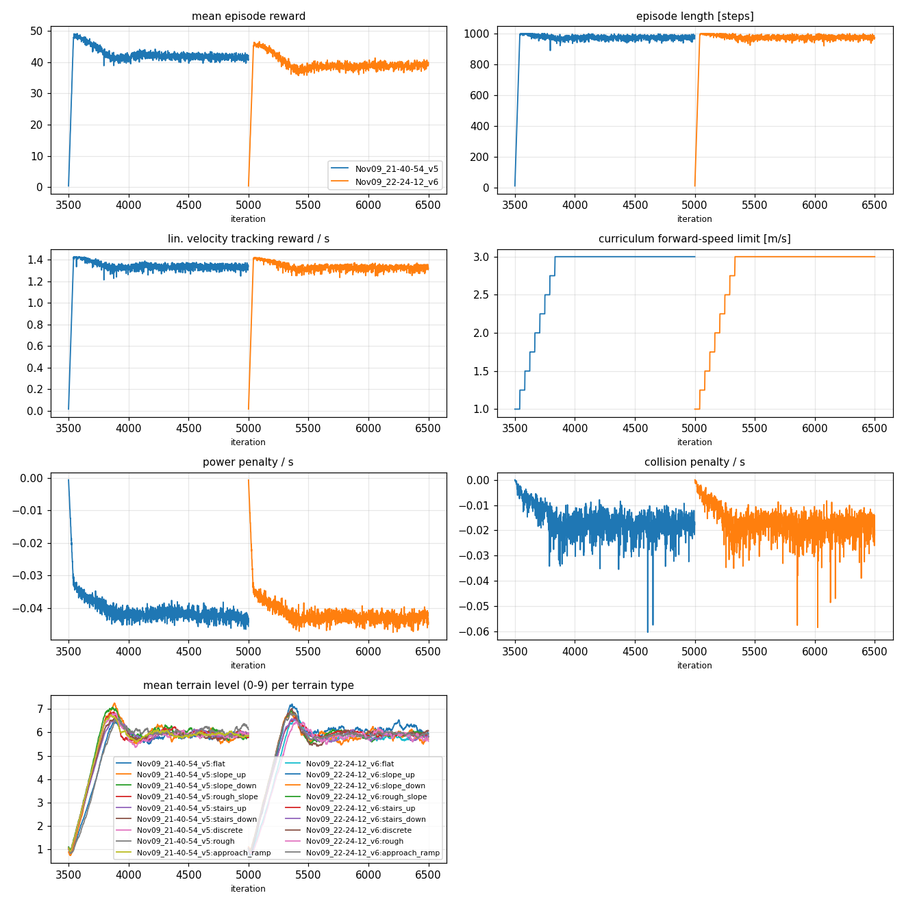

### 5.3 摩擦是不是太小

不是。坡和台阶的滑动摩擦都是 1.0，Isaac 训练时在 0.4–1.25 之间随机。30° 坡上脚不往下溜只需要约 0.58。卡住时支撑脚切向速度接近 0，是踩住之后身体抬头、速度掉到 0。把摩擦调到 1.4 且接触改硬，有一次爬过 30°；1.2 和 1.6 又停住。摩擦不是一个稳定的开关。

### 5.4 接下来

- 平地高速权重在桌面 `ElbowDog_平地高速权重.zip`。那是 48 维观测的平地网络，不能拿去爬坡。
- v6 的 25° 比 v5 的 0.43 m/s 慢很多，打滑系数保持 v5 的 −1，不再加大。
- 30° 仍然在坡脚停住。v7 从 v5 的 `model_5000.pt` 接着训，奖励回到 v5，只把 PhysX 接触柔度随机到 0–1e-4 m/N，让策略见过更软的地面。
